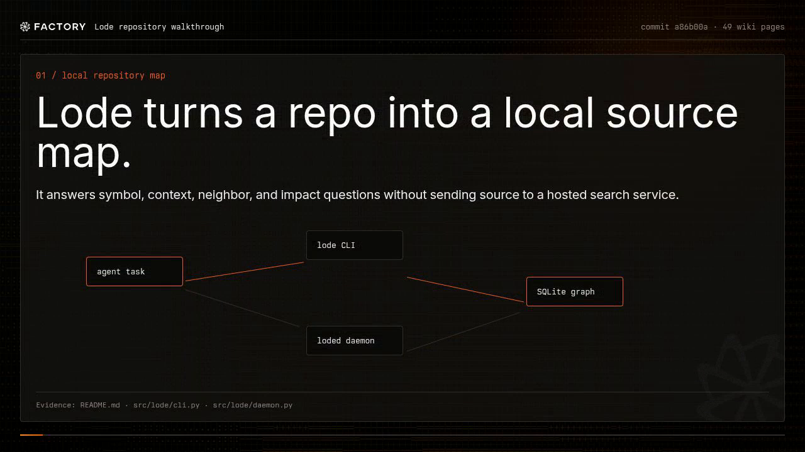

# Lode

Lode is a fast, local-first codebase map for coding agents, written in Rust.

It indexes source files into bundled SQLite + FTS5 for cheap per-turn lookup. It answers: where is this symbol, what should I read, what calls this, and what might break if I touch it — without sending the repo to a hosted code-search service.

[](https://app.factory.ai/wiki/a71cbea2-853d-40f7-a479-f1e8d6af8252)

## Goals

- **Local by default**: single native binary, bundled SQLite, no account or hosted API required.
- **CLI first**: agents call `lode` directly and get bounded JSON with `path:line` citations.
- **Fast hot path**: ~3 ms context retrieval and sub-second indexing on typical repos.
- **Daemon-friendly**: run `loded` when you want a warm local HTTP service.

## Features

- `lode index PATH` for Python (`ruff_python_parser`), TypeScript/JavaScript, Markdown, and config files (respects `.gitignore` and `.git/info/exclude`).
- `lode search QUERY --json` over SQLite FTS5 with weighted BM25.
- `lode symbol NAME --json` for exact/partial symbol lookup.
- `lode context QUERY --json --budget N` for a token-budgeted agent context pack.
- `lode impact TARGET --json` for callers, callees, receiver-aware call resolution, import-filtered blast radius, and affected `Route` entrypoints.
- `lode neighbors NODE_ID --json` for direct graph neighbors.
- `loded` local HTTP daemon with `/health`, `/status`, `/index`, `/search`, `/context`, and `/metrics`.
- `lode embed` for optional local embeddings services (loopback or Docker `embeddings` host only).
- Optional `--features embed` Cargo feature for a local CPU reranker (`lode context --rerank`, off by default).

## Install & Build

Requires Rust 1.85+:

```bash
cargo install --path .
lode --help
```

Or build release binaries directly:

```bash
cargo build --release --bins
./target/release/lode --help
```

### Install the agent skill

This repo ships a reusable coding-agent skill at `skills/lode/`:

```bash
AGENT_SKILLS_DIR="/path/to/your/agent/skills"
mkdir -p "$AGENT_SKILLS_DIR/lode"
cp -R skills/lode/. "$AGENT_SKILLS_DIR/lode/"
```

## Quick start

```bash
lode index ~/Projects/lode
lode search "knowledge graph" --json
lode context "how does indexing work" --json --budget 4000
lode impact blast_radius --json
```

Run the local daemon:

```bash
loded --host 127.0.0.1 --port 7979
```

Use Docker Compose:

```bash
docker compose up -d --build
curl http://127.0.0.1:7979/health
```

## CLI commands

```bash
lode index PATH [--data-dir DIR]
lode status [--json]
lode search QUERY [--repo PATH] [--limit N] [--json]
lode symbol NAME [--repo PATH] [--limit N] [--json]
lode context QUERY [--repo PATH] [--budget N] [--from-path PATH] [--json]
lode impact TARGET [--repo PATH] [--limit N] [--neighbor-limit N] [--depth N] [--max-nodes N] [--direction up|down|both] [--json]
lode neighbors NODE_ID [--json]
lode embed [--limit N] [--url URL] [--model MODEL] [--json]
lode serve --host 127.0.0.1 --port 7979
```

## Storage layout

Default data directory (`LODE_DATA_DIR`, `KG_DATA_DIR`, or `~/.local/share/lode`):

```text
~/.local/share/lode/
  lode.sqlite
```

## Benchmarks

### RepoBench-R retrieval (300/bucket, merged paths, 5 query lines)

| Split | Bucket | Hit@1 | Hit@3 | Hit@5 | Hit@10 | MRR | Median ret |
|---|---|---:|---:|---:|---:|---:|---:|
| `cross_file_first` | lt5 | 0.423 | 0.930 | 0.983 | 0.983 | 0.667 | 3.06 ms |
| `cross_file_first` | easy | 0.257 | 0.620 | 0.857 | 0.997 | 0.486 | 3.48 ms |
| `cross_file_first` | hard | 0.213 | 0.423 | 0.563 | 0.837 | 0.383 | 3.58 ms |
| `cross_file_random` | lt5 | 0.580 | 0.953 | 0.987 | 0.987 | 0.767 | 3.06 ms |
| `cross_file_random` | easy | 0.413 | 0.750 | 0.920 | 0.990 | 0.609 | 3.13 ms |
| `cross_file_random` | hard | 0.280 | 0.547 | 0.690 | 0.897 | 0.459 | 3.43 ms |

### Blast radius & call resolution

Run the ground-truth precision/recall eval and real-repo audit:

```bash
python3 scripts/blast_radius_eval.py
```

## Validation

```bash
cargo fmt --check
cargo clippy --all-targets -- -D warnings
cargo test
```

## License

Apache-2.0.
